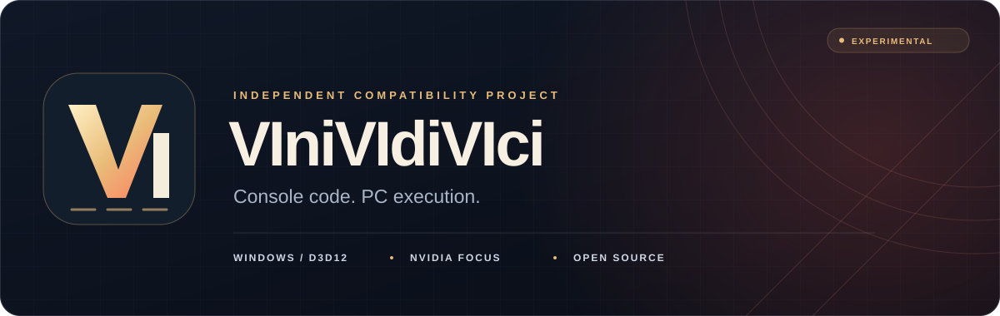

<p align="center"></p>
<p align="center"><strong>Una capa de compatibilidad experimental para Xbox Series en Windows, centrada en NVIDIA.</strong></p>
<p align="center"><a href="README.md">English</a> · <strong>Español</strong></p>

---

## El proyecto

**VIniVIdiVIci** reúne correcciones de compatibilidad, comprueba su comportamiento en una **RTX 4060 Ti** y documenta su procedencia y sus límites. El nombre le da su propio **VI** a cada parte de *veni, vidi, vici*.

Partimos de [victory-fork](https://github.com/fxceless/victory-fork) y [VIctory](https://github.com/Marvisak/VIctory). El código x86-64 del título se ejecuta de forma nativa en la CPU; los programas de la GPU de consola se traducen para Direct3D 12.

> **Estado: experimental. Llega al mundo del juego y el jugador controla al personaje, a una mediana de 6,5 fotogramas por segundo en juego en la primera sala en nuestro equipo, con bajones mientras carga una zona.** En [Estado](#estado) está lo que hemos medido y lo que solo está observado. No es jugable y no atribuimos ninguna mejora de FPS a los cambios de este fork. Los resultados de otros proyectos corresponden a sus versiones y equipos.

El repositorio no incluye archivos del juego, sus recursos ni material del SDK de consola. Debes aportar tus propios archivos y guardarlos fuera del repositorio. Es un proyecto comunitario independiente, sin afiliación con fabricantes o editoras.

## Qué aporta

El fork sigue a victory-fork y está fusionado hasta su `988aa41` (25 de noviembre de 2026; 66 commits desde la fusión anterior, en `79cfdd9`). Esa fusión trae, encendidos por defecto: los bytes cambiados se buscan de 64 en 64 con una máscara (`VICTORY_CHANGED_RUNS=0` vuelve al paseo byte a byte), un pipeline del host para un draw sobre una superficie de otro formato que el que declara su pipeline, una vista de una textura que escribió la tarjeta copiada desde ella aunque la lista ya hubiera subido esa vista desde la memoria del título, vistas de búfer constante limitadas a los 64 KiB que admite el host, partidas guardadas que ya no fallan por una versión anterior que no se puede borrar, y un informe más completo cuando se pierde la tarjeta. Su propio arreglo de la mezcla sobre superficies de enteros sustituye al que habíamos portado. Apagados por defecto, a medir aquí de uno en uno: `VICTORY_CARD_BUFFERS_MIN_KB`, `VICTORY_CARD_HASH_WIDE=1`, `VICTORY_CARD_HASH_LEN=1`, `VICTORY_CARD_SYNC_BATCH=1`, `VICTORY_LOOKUP_CACHE=1`, `VICTORY_LIGHT_REFRESH=1`, `VICTORY_STEP_INDEX=1`, `VICTORY_FILLS_PLAIN=1`, `VICTORY_LIST_REUSE=1`, `VICTORY_HEAP_PASS_MARKED=1`, `VICTORY_HEAP_SYNC_CUT=1`, `VICTORY_GATHER_BY_COPY=1`, `VICTORY_TEXTURE_BACK=1` y `VICTORY_BVH_NO_HIT=1`. Medido en este equipo con todo lo que trae en su valor por defecto, mismos ajustes y maniobra que el par de Estado, una sesión, con su caché de shaders fría: 1663 frames, 5,94 fps, frame mediano de 165 ms (percentil 95 de 209 ms), frente a 1678 frames, 5,99 fps y 164 ms antes de la fusión. Sin cambio, como era de esperar con su trabajo de FPS detrás de interruptores. El README del original, con lo que midió en su equipo (un i7-14700KF y una RTX 4070 de 12 GB: de 9 a 12 fps en salas, con un conjunto de interruptores que aquí aún no está medido), se conserva como `README.upstream.md`. Fusiones anteriores trajeron, encendidos por defecto, un contador de fps dibujado en la esquina de la imagen (`VICTORY_FPS_COUNTER=0` lo quita) y lecturas de DirectStorage a páginas físicas que esperan al Submit del título. Lo de abajo es lo que añadimos encima.

| Área | Corrección | Procedencia |
| :--- | :--- | :--- |
| **64 lanes → 32 hilos** | Ejecución por parejas de programas compute wave64 en GPU de 32 lanes, junto con los demás cambios de esa PR. | [#854](https://github.com/fxceless/victory-fork/pull/854), PiloteCode |
| **Límites de memoria** | Las lecturas y escrituras anchas que cruzan una página de 64 KiB usan el mapeo de cada página. | [#846](https://github.com/fxceless/victory-fork/pull/846), gomeaw |
| **Píxeles auxiliares** | Corrige `v_readfirstlane` para que las helper lanes completen el bucle probado en la primera pasada. | [0601955](https://github.com/Marvisak/VIctory/commit/0601955361c77fd8e306631784ed084a31e5ad8f), Vax |
| **Actualización de texturas** | Si se desborda la lista de avisos de remapeo, se revisan las texturas colocadas. Conservamos el límite de memoria y sincronizamos la marca de desbordamiento con la lista. | [74315e7](https://github.com/PastiiJay/klbf-lab/commit/74315e765a6a7b24a926e55f9b2a192d6b8ec05a), PastiiJay / KLBF Lab |
| **Programas del reescalador y más instrucciones** | Las imágenes FSPX del reescalador FidelityFX se leen como programas nativos, y se traducen varias instrucciones y formas de descriptor que antes se rechazaban. Adaptado a la ejecución por parejas, con una prueba nuestra para las lecturas que siguen a una sección de ola completa. De los 29 programas del reescalador del título, 28 se traducen, validan y crean pipeline en la RTX 4060 Ti; antes, ninguno. No hemos comparado la imagen con y sin este cambio. El perfil Series S lo necesita para dibujar. | [#258](https://github.com/fxceless/victory-fork/pull/258), Ortomanic |
| **Series S: el segundo plano** | En el perfil Series S el título presenta dos planos, su imagen y su interfaz, y solo se mostraba el primero: el selector de perfil, las imágenes de carga y el vídeo inicial salían negros. Ahora el segundo plano se dibuja sobre el primero, y el escalado que pide el título pasa a ser un estirado simple. El tamaño de la descripción de un plano no sale de la documentación de Microsoft; varias personas confirman que funciona con el mismo título. | [#188](https://github.com/fxceless/victory-fork/pull/188), sagouindupm y Filip722 |
| **Texturas en una tarjeta de 8 GB** | `VICTORY_TEXTURE_DROP_MIPS=N` deja fuera de la copia en la tarjeta los N niveles más grandes de cada textura; cada nivel que se deja fuera son tres cuartos de sus bytes. Apagado por defecto. Su autor lo midió en una RTX 4060 Ti de 8 GB; nuestra medida está pendiente. | [#610](https://github.com/fxceless/victory-fork/pull/610), ofc0urse y Filip722 |
| **Copias entre la memoria del título y la tarjeta** | `VICTORY_CENSUS=1` registra, por cada copia de memoria del título en la tarjeta, cuánto se sube, se compara y se trae de vuelta. `VICTORY_SKIP_WC_BACK=1` es un experimento: lo que los shaders escriben en memoria que el título reservó como write-combining se queda en la tarjeta y no se trae de vuelta; sus autores avisan de posibles artefactos y marcan `VICTORY_SKIP_WC_COMPARE=1` como inseguro. Todo apagado por defecto; nuestra medida está pendiente. | [#868](https://github.com/fxceless/victory-fork/pull/868), Chipsrain e iGoldenNinja |
| **Una vista por sección** | `VICTORY_XMEM_PERSISTENT_VIEW=1` mantiene una vista de cada sección de páginas físicas para las escrituras de DirectStorage, en vez de mapear, confirmar y desmapear en cada escritura. Apagado por defecto; sin medir aquí todavía. | [#231](https://github.com/fxceless/victory-fork/pull/231), HailLucifer666 |
| **Pruebas sin nadie delante** | En las builds de diagnóstico, una tecla programada con `VICTORY_KEYS` se mantiene pulsada hasta que las lecturas del título la han visto (una vez por defecto, `VICTORY_KEYS_READS`), en vez de 0,2 s fijos, que a entre uno y tres frames por segundo caían entre dos lecturas. Las pulsaciones pueden repetirse (`150:Enter*3/20`) o mantenerse un tiempo fijo para andar (`430:W~5`, cinco segundos, también con un mando real conectado), y cada una deja una línea en el registro que dice si el título la leyó y cuántas veces. | este fork |
| **Sustituto de la luz indirecta** | Sin trazado de rayos la luz indirecta del título queda en casi nada, y lo que no ilumina el sol sale negro. `VICTORY_AMBIENT=<nivel>` cambia lo que escribe el programa que resuelve esa luz por una constante: con color (`VICTORY_AMBIENT_TINT`), sombreada en pliegues y bajo los objetos a partir de la profundidad de la escena (`VICTORY_AMBIENT_SHADE`), con los reflejos limitados a ella (`VICTORY_AMBIENT_REFLECT`) y ajustable con el juego en marcha desde un fichero en las builds de diagnóstico (`VICTORY_AMBIENT_FILE`). Apagado por defecto aquí, y entonces no cuesta nada; su autor lo usa a 0,6. Sin probar todavía en este equipo. | [VIctory-Belobug-AMD](https://github.com/Belobug/VIctory-Belobug-AMD) de Belobug (beloooo); primera versión a través del [#917](https://github.com/fxceless/victory-fork/pull/917), UwUCammie |
| **Memoria del título en su sitio** | `VICTORY_STRETCH=1`: una ventana de memoria del título que es una sola tira de páginas de una sección la usa la tarjeta a través de una vista nuestra de esa sección, sin copia, sin refresco y sin copia de vuelta; lo que no se puede abrir así se copia como antes. Funciona sin `VICTORY_INPLACE`. Apagado por defecto. Su autor no midió una ganancia clara en una NVIDIA de 16 GB. Medido aquí en una sala: con las ventanas habituales de 4 MiB se colocaron tres y el frame no cambió; con ventanas de 256 KiB (`VICTORY_WINDOW_KB=256`) hubo unas 800 en sitio, unos 280 MB de 2,3 GB, ninguna rechazada por el controlador, y el frame mediano fue de 312 ms frente a 296-297 ms sin ninguno de los dos interruptores. Sin ganancia en este equipo. | [#1127](https://github.com/fxceless/victory-fork/pull/1127), FrancescoGelosoEterea, a partir del `VICTORY_STRETCH` de Belobug |
| **Draws perdidos por un pipeline rechazado** | El título deja la mezcla activada sobre superficies de enteros; la consola la ignora ahí, Direct3D 12 no la permite y el host rechazaba el pipeline entero: en las primeras salas un pipeline de mesh, que se dibuja menos de una vez por frame (de 0,3 a 0,5 draws por frame en el registro). Ahora la mezcla se apaga solo en las superficies de enteros y el resto del estado se conserva; desde entonces no se rechaza ningún pipeline en las sesiones miradas. No se afirma ningún cambio visible. | [Marvisak/VIctory#1152](https://github.com/Marvisak/VIctory/pull/1152), Pablo González, portado a este árbol |
| **Texturas más allá de la memoria propia de la tarjeta** | `VICTORY_TEXTURE_SPILL=1`: cuando la memoria propia de la tarjeta está llena, las copias de las texturas que los shaders eligen por índice siguen en la memoria del PC que el sistema comparte con la tarjeta, hasta la mitad de su presupuesto, en vez de esperar y leerse vacías. Apagado por defecto: esa memoria es la del PC, que es la que falta en este equipo. Sin medir aquí todavía. | [VI-BR-PORT](https://github.com/edsuuu/VI-BR-PORT) de edsuuu, a partir del [#601](https://github.com/fxceless/victory-fork/pull/601), DiogoPCastelos |
| **La pasada por el montón de descriptores** | En cada frame la capa recorre el montón de descriptores del título y refleja lo que cambió: unos 240 000 huecos mirados para 13 000 registros reflejados, 68 ms de procesador por frame en la primera sala (132 ms con `VICTORY_HEAP_SYNC_TABLES=1`, un interruptor de diagnóstico que nuestras sesiones llevaron puesto hasta el 26 de noviembre). Dos cambios la dejan en 34 ms: el #1043 evita que la pasada se vuelva a encolar a sí misma, toma sus candados una vez por página y busca cada copia una sola vez; el #1190 guarda los huecos hechos y cambiados con un bit por hueco, en orden. Medido aquí, cada uno solo y los dos juntos: véase Estado. | [#1043](https://github.com/fxceless/victory-fork/pull/1043) y [#1190](https://github.com/fxceless/victory-fork/pull/1190), UwUCammie |
| **Ventanas en la tarjeta contadas una vez** | Con `VICTORY_CARD_WINDOWS_MB` puesto (apagado por defecto) una ventana de memoria del título puede tener un búfer en la memoria de la tarjeta, por uno de dos caminos. Cada camino contaba la ventana contra el tope por su cuenta, con una suma y una resta que otro hilo podía ver a medias, así que cerca del tope se rechazaba una ventana con sitio libre; y se preguntaba al driver por el presupuesto de la tarjeta antes de mirar el tope. Ahora hay una sola reserva para los dos caminos, que se devuelve si ninguno crea su búfer, y el tope se mira primero. Un fallo de la prueba del heap de subida se recuerda. Sin el interruptor no cambia nada. Aún sin medir aquí. | [#1250](https://github.com/fxceless/victory-fork/pull/1250), UwUCammie |
| **Una textura corta en vez de una negra** | Cuando en la tarjeta no cabe una textura que elige un draw, la capa la retiene y la superficie no muestra nada. Con `VICTORY_TEXTURE_SHORT=1` (apagado por defecto) esa textura se crea solo con sus niveles de hasta 256 texels, unos 87 KB, mientras el uso de la tarjeta más lo reservado para otros esté por debajo del 97 % de su presupuesto: borrosa, no negra. A diferencia de `VICTORY_TEXTURE_DROP_MIPS`, que quita siempre el nivel mayor a todas las texturas, esto solo acorta las que no caben, cuando no caben. Una textura creada corta sigue corta mientras se use. Por ahora solo pruebas; sin medir ni mirar en el juego aquí. | LoverCatys/ruff-lab `ac473bf2`, a partir de ka1qux |
| **Memoria intermedia de texturas que no cambian, liberada** | Cada textura que rellena el título conserva en la memoria del PC un búfer de su tamaño, que solo se usa entre un detile y la subida. Con `VICTORY_STAGING_RELEASE=1` (apagado por defecto) se suelta el búfer de una textura ya subida que lleva dos segundos y treinta frames sin cambiar, y se rehace cuando cambia; su hash se conserva, así que mientras tanto no se vuelve a detilar ni a subir. Es para la memoria del PC, no la de la tarjeta: el juego ocupa aquí de 16 a 18 GB. Por ahora solo pruebas; sin medir en el juego aquí. | LoverCatys/ruff-lab `af3322dd` |
| **Hilos de consola en grupos de cálculo de varias waves del host** | Un programa traducido que pregunta qué hilo de consola es tomaba la respuesta del número plano de la primera lane de su wave, redondeado hacia abajo. Eso solo vale donde una wave del host es una tirada de hilos consecutivos; en un grupo de dos dimensiones NVIDIA (y AMD en waves de 32) llena las waves con baldosas de 16 por 2, dos waves redondean a la misma base y la mitad de los hilos toma los números de la otra mitad. Una sonda en esta RTX 4060 Ti escribió 32 de 64 palabras; con el arreglo, 64 de 64, una vez cada una. Ahora las waves toman sus hilos de un contador del grupo, como ya hacían los programas wave64 en mitades; la forma pareada de este árbol conserva su propia cuenta (128 de 128 en su prueba). `VICTORY_THREAD_TICKET=0` vuelve a lo anterior. En una sesión hasta la primera sala, 11 de los 3243 programas traducidos tomaron el contador. Mirado con él puesto y quitado en la misma compilación, en esa sala: no se vio diferencia, ni a mejor ni a peor, en los momentos en que se miró, y no se vio ninguna cara de frente. | [#1261](https://github.com/fxceless/victory-fork/pull/1261), Garu667 |
| **Una vista raw no se sale de su búfer** | El desplazamiento y la longitud del título pasaban a una vista raw sin compararlos con el búfer. Direct3D 12 rechaza sin avisar una vista que se sale de su búfer y el hueco queda indefinido. Ahora la longitud se recorta a lo que tiene el búfer, y una vista que empieza pasado el final, o fuera de los 16 bytes que pide una vista raw, es una vista nula; una vista legal queda como estaba. Contado por causas: ninguna en la sesión de arriba, así que es una guarda para escenas que aún no hemos visto. | [#1266](https://github.com/fxceless/victory-fork/pull/1266), lichenlang89 |
| **Licencia** | Quitamos la emulación de las instrucciones de procesador exclusivas de AMD que victory-fork había portado de XCL, que es GPL-2.0-only: este programa es GPL-3.0-or-later y no puede llevarla. Ese trabajo lo hace ahora el manejador propio de VIctory. Comprobado en un procesador Intel, donde el título depende de ello para arrancar. | [#1057](https://github.com/fxceless/victory-fork/pull/1057), nullexxx |
| **Hilos de pipelines** | `VICTORY_PIPELINE_WORKERS=<n>` y `VICTORY_PIPELINE_NORMAL=1` fijan cuántos hilos crean pipelines y con qué prioridad. Apagados por defecto. | [#955](https://github.com/fxceless/victory-fork/pull/955), LukaManstein |
| **Watchdog del título** | `VICTORY_NO_WATCHDOG=1` salta el watchdog de cuelgues del propio título en una versión conocida, comprobando antes la versión y los bytes que sustituye. Apagado por defecto y sin usar en la medida de abajo. | [#959](https://github.com/fxceless/victory-fork/pull/959), ruvenesh |
| **Pruebas estables** | Tres fallos intermitentes de tests eliminados: los de vigilancia de memoria, el de ficheros y el de esperas de frame. | [#963](https://github.com/fxceless/victory-fork/pull/963) y [#952](https://github.com/fxceless/victory-fork/pull/952), MamaLeVrai; [#978](https://github.com/fxceless/victory-fork/pull/978), avt0m4t48 |

Son correcciones de comportamiento con pruebas de regresión. No equivalen a una mejora de FPS demostrada ni a una solución completa del renderizado.

## Compilar y ejecutar

Necesitas Windows 10/11 x64, una CPU con AVX2, una GPU Direct3D 12 con Shader Model 6.6 y mesh shaders para el mundo, [Rust](https://rustup.rs/), las herramientas C++ de MSVC y un Windows SDK. La versión de Rust está fijada en `rust-toolchain.toml`.

```powershell
git clone https://github.com/KomanderDG88/VIniVIdiVIci.git
cd VIniVIdiVIci
Copy-Item victory.example.toml victory.toml
```

Edita `victory.toml` con las rutas de tus archivos, caché y datos guardados, siempre fuera del repositorio. Comprueba las rutas y compila:

```powershell
cargo run -p victory -- config
cargo build --release -p victory
.\target\release\victory.exe run "D:\TuTitulo\titulo.exe" --execute
```

Sustituye la ruta de ejemplo por tu ejecutable. El programa y las variables mantienen sus nombres heredados: **`victory` y `VICTORY_*`**. Deja margen de memoria comprometida disponible en Windows.

Puedes usar un mando XInput, y un DualSense de Sony (el mando de PlayStation 5) conectado por USB o Bluetooth se lee directamente como primer mando, sin controlador ni programa auxiliar (`VICTORY_SONY_PAD=0` lo deja en paz; sin vibración todavía; la lectura de sus informes está probada con tests, con el mando en la mano aún no). Sin mando, el teclado actúa como uno mientras la ventana tiene el foco: **WASD / IJKL** para los sticks, **Enter** para A, **Backspace** para B y **Esc / Tab** para Menu / View. [Controles completos y guía heredada](README.upstream.md#getting-started).

## Qué hemos comprobado

En Windows, con RTX 4060 Ti y controlador 617.42:

- **Base `1dc8914`:** 247 pruebas de shaders superadas y 2 ignoradas; 170 de GPU superadas y 5 ignoradas.
- **Arreglo de texturas `158676e`:** las 19 pruebas de descriptores superadas. Al desactivar la corrección, la nueva prueba detecta el fallo.
- **Píxeles auxiliares:** 18 de 18 vecinos atendidos tanto en hardware como en WARP.
- **LDS con ejecución por parejas:** dos casos sintéticos repetidos 30 veces, incluido un grupo de 128 hilos.
- **Con el #258 fusionado:** 252 pruebas de shaders superadas y 2 ignoradas; la prueba nueva de lectura de lane tras la sección, 10 de 10 con 24 de 24 envíos por parejas en cada pasada, y tres mutaciones que la hacen fallar.

Algunas rutas de prueba se omiten si falta compilador o dispositivo: el contador de pruebas superadas no garantiza que se hayan ejecutado todas las rutas de hardware. WARP no cubre aquí la ruta por parejas con `WaveSize(32)`.

**Batería de GPU, estabilizada:** los fallos intermitentes de la batería completa de GPU (la liberación de memoria del test de buffers in-place de WARP, una violación de acceso de WARP con tests simultáneos y el orden de grupos del test de presupuesto indirecto) quedan corregidos con fxceless/victory-fork#878 (MamaLeVrai), #875 (eazyves) y un recorte que lanza un grupo por cada 64 registros, a partir del #864 (xiaotu030202). Treinta ejecuciones del binario completo de tests de `victory-gpu` en una RTX 4060 Ti: 30 de 30 limpias (171 superadas, 5 ignoradas), frente a 25 de 30 antes. El cambio del recorte cuesta unos 1,4 µs por cada 64 registros y no es una mejora de fps. La pasada posterior de victory-fork que recorta de una vez los registros dispersos de cada lista (`VICTORY_INDIRECT_GATHER=1`) lanzaba todos sus grupos a la vez y contaba con el índice antiguo del shader; aquí lanza un grupo por cada 64 registros como las demás pasadas, con un test de 130 registros dispersos que falla si se repone el lanzamiento único. Diez ejecuciones del binario con ello: 10 de 10 limpias (196 superadas, 5 ignoradas).

Los comandos de verificación y sus requisitos están en [Validation](README.md#validation). Estas cifras describen pruebas sintéticas, **no rendimiento del juego**.

## Estado

A 25 de noviembre de 2026, con **Windows 11, RTX 4060 Ti, controlador 617.42, Core i7-8700K y 32 GB de RAM**, y los archivos del título en un SSD NVMe.

| | Estado | Notas |
| :--- | :--- | :--- |
| En el juego | El jugador controla al personaje y el menú de pausa se abre | Lo comunica quien lo ejecuta, a las 18:36, en una sesión en Series S con la compilación `6dc5f86` (el código de `main`): el personaje responde a la entrada. Sin instrumentar. Después, en una sesión sin nadie delante con `d816f3f` y un Enter programado, el título pasó solo del aviso de inicio a la carga, a las escenas iniciales y a una escena interior que muestra el aviso del juego para moverse y mover la cámara; la entrada probada allí a mano, con toques cortos, no dejó ver nada que se distinguiera de una animación. **Confirmado esa misma tarde con entrada programada** (`VICTORY_KEYS`, compilación `7a262f3`, el código de `main`), sin nadie al teclado: la palanca derecha mantenida cuatro segundos giró la cámara, la izquierda mantenida cuatro segundos giró y desplazó al personaje (vistas comparadas antes y después) y el botón de menú abrió la pausa; el registro de la capa recoge cada una de esas pulsaciones como leída por el título. Una cuarta, la palanca hacia atrás, no se leyó y no demuestra nada en ningún sentido. |
| FPS en el mundo | **Mediana en juego: 6,5 fps** (frame mediano de 147 ms) en la primera sala, con interruptores puestos que por defecto van apagados; 7,3 fps con uno más, al que un comprobador le encontró después un fallo y que no se recomienda. Bajones mientras carga una zona | **Lo último, con el código de `main` (compilación `bfb2072`), mediana en juego:** en la primera sala con una maniobra programada de 280 s (la cámara gira y el personaje anda cada 20 s; unos 4500 draws por frame), con `VICTORY_SKIP_WC_BACK=1`, `VICTORY_COPY_PLAIN=1` y `VICTORY_TEXTURE_DROP_MIPS=1`: 1678 frames, **5,99 fps, frame mediano de 164 ms** (percentil 95 de 204 ms); y tras la fusión del original (compilación `55160ae`, con su caché de shaders fría) 1663 frames, 5,94 fps y 165 ms. Una sesión de cada. Sin medir sin esos interruptores. **Con diez interruptores más del original puestos, en conjunto** (`VICTORY_ASYNC_SUBMIT=1`, `VICTORY_QUEUE2=1`, `VICTORY_JOIN_PARTS=1`, `VICTORY_BACK_OWN_VIEW=1`, `VICTORY_INDIRECT_GATHER=1`, `VICTORY_CARD_REHASH_RUNS=1`, `VICTORY_CARD_HASH_LEN=1`, `VICTORY_MERGE_GAP=64`, `VICTORY_MERGE_RUNS=4096`, `VICTORY_STAGING_POOL=0`), misma compilación `55160ae` y maniobra, una sesión: 1825 frames, **6,52 fps, frame mediano de 147 ms** (percentil 95 de 198 ms); por minutos desde la primera tecla 6,49, 6,56, 6,46, 6,57, 6,62 y 6,54 fps, frente a 5,96, 5,98, 5,94, 5,89, 5,95 y 5,97 sin ellos. Un conjunto, no una causa: qué da cada uno de los diez no está medido, la sala se veía como sin ellos en los momentos en que se miró, y `VICTORY_MERGE_GAP` no es exacto según la nota de su propio autor. **Con `VICTORY_INDIRECT_WINDOW=1` añadido a esos diez**, misma compilación y maniobra, una sesión: 2045 frames, **7,31 fps, frame mediano de 133 ms** (percentil 95 de 210 ms); por minutos 7,37, 7,19, 7,25, 7,46, 7,53 y 7,38 fps. El tiempo de la tarjeta en las listas del propio título bajó de 91 a 53 ms por frame. En esta sesión no se perdió el dispositivo; el original lo perdió una vez de ocho con este interruptor, así que una sesión aquí no lo descarta. La carga anterior a la sala tardó más y enseñó un frame en blanco un momento, y quien miraba vio unos rectángulos oscuros en lo alto de una pared de la sala que no recordaba de la sesión sin el interruptor: aún sin comparar de forma controlada, así que ni se le atribuye al interruptor ni se descarta. **Después se le encontró un fallo a ese interruptor.** El comprobador del propio original (`VICTORY_INDIRECT_WINDOW_CHECK=1`), en una sesión aparte con la misma compilación y el mismo conjunto, comparó 8,05 millones de registros que los draws leyeron de una ventana con un cálculo fresco de cada uno: uno difería, un registro sin índices donde el fresco tenía 6 índices por 32 instancias, de modo que ese draw no dibujó nada. Uno entre millones, a los 476 s de esa sesión, en las escenas anteriores a la sala, y nadie lo ha relacionado con los rectángulos; pero el interruptor lee a veces un registro viejo, y mientras eso no se arregle `VICTORY_INDIRECT_WINDOW` no se recomienda y la cifra a tener en cuenta es la de los diez interruptores, 6,52 fps. Lo que limita el frame con los once puestos, según las cuentas de la propia capa: su hilo de envío trabaja 123 de los 126 ms de un frame habitual, 89 de ellos preparando, de los que 75 son copias de memoria del título (39 de esos preguntando a Windows, unas 2000 veces por frame, qué páginas se escribieron) y 20 esperando a la tarjeta, casi toda esa espera por dos copias de 2 KiB por frame que el título hace de bytes que la tarjeta escribe en ese mismo frame. La tarjeta está ociosa 54 ms de cada frame: con este conjunto el límite es el procesador, no la tarjeta. Con qué se comparan, una corrección a las cifras publicadas antes del 26 de noviembre y todas las cifras anteriores están en [Historial de medidas](#historial-de-medidas). RTX 4060 Ti. |
| Estabilidad | 46 minutos en una sesión sin caídas | Series S, compilación `9b08008` con `VICTORY_SKIP_WC_BACK=1`, `VICTORY_COPY_PLAIN=1`, `VICTORY_AMBIENT=3` y `VICTORY_TEXTURE_DROP_MIPS=1`: 2812 s hasta el límite de la sesión, con sus procesos cerrados después por la suite de pruebas. El aviso de movimiento del juego se vio por primera vez a los 8 minutos; desde esa primera vista del mundo hasta el final, 38 minutos y 44 s, hubo frames registrados en todas las ventanas de cinco minutos, el título leyó las 25 pulsaciones programadas que movían la cámara y al personaje, y una persona jugó parte de la sesión y fue de la primera sala a un pasillo con otros personajes. La imagen solo se miró en momentos sueltos (esa primera vista y la captura de quien jugaba, 27 minutos después), así que no está demostrado que el mundo estuviera en pantalla ni bajo control todo el tiempo. Antes, ese mismo día: 924 s hasta el límite de la sesión, con `VICTORY_TEXTURE_ROOM_PERCENT=95`. Otra sesión de 30 minutos también llegó a su límite, pero su cierre no quedó registrado limpiamente y no la contamos. Esa misma tarde, siete sesiones de diez minutos sin nadie delante en Series S con `VICTORY_TEXTURE_DROP_MIPS=1` llegaron todas a su límite sin caída. En Series X dura menos en este equipo: se queda sin memoria física. |
| Imagen | Con `VICTORY_AMBIENT=3` (apagado por defecto) una escena interior queda iluminada en luz y en sombra, con defectos visibles; sin él, el mundo 3D sale casi todo oscuro. Las imágenes de carga, los subtítulos y los avisos se ven | Series S: el selector y las imágenes de carga se ven desde el #188 (medido aquí: dos planos en Series S, uno en Series X) y la sesión sigue hasta el juego. La imagen 3D sale casi negra y sin detalle, y las texturas se ven mal; los subtítulos y avisos del plano de interfaz se leen. Con `VICTORY_AMBIENT=0.6`, en una sesión, se vieron las paredes y una cama de una escena interior, mientras que un plano anterior de esa misma sesión seguía muy oscuro. En esa sala, un mismo encuadre con tres niveles puestos con el juego en marcha: a 3 las paredes, la cama, el pelo y el personaje se ven claramente más que a 0,6; a 12 paredes y personaje se queman. Así que la imagen oscura responde a esa luz, y el nivel que le va a una escena no es un número único. Lo que no arregla: artefactos en el pelo y el lado de una cara que siguió negro a 0,6 con las paredes iluminadas; a 3, un primer plano salió con los ojos blancos y brillantes y un pasillo demasiado claro. Quien jugó la sesión larga vio el brazo de un guardia dibujado con bloques de muchos colores y bocas mal dibujadas; la causa no está resuelta (véase Próximos pasos). Series X: sombras negras. |

Cómo medimos: los tiempos de frame que la capa anota cada unos cinco segundos, solo en el mundo y por escena. Las cifras salen de compilaciones de diagnóstico, que cuestan tiempo de frame. Un equipo y unas pocas sesiones.

## Primera medida dentro del juego

Registrada el 25 de noviembre de 2026 en el commit `abf1575`, con **Windows 11, RTX 4060 Ti, controlador 617.42, Core i7-8700K (6 núcleos, 12 hilos) y 32 GB de RAM**, y los archivos del título en un disco duro de 5400 rpm. Compilación de diagnóstico, perfil Series X, `VICTORY_HEAP_SYNC_TABLES=1`, registro de frames y medidor de la tarjeta activados.

| Ejecución | Ventana de 60 s | Frames | Media | Tiempo de frame p5 / p50 / p95 |
| :--- | :--- | ---: | ---: | :--- |
| A | Primera ventana en el mundo | 222 | 3,6 fps | 161 / 262 / 429 ms |
| A | Unos tres minutos después | 188 | 3,0 fps | 115 / 303 / 672 ms |
| B, añadiendo `VICTORY_INDIRECT_WINDOW=1` | Último minuto | 306 | 5,0 fps | 161 / 195 / 242 ms |

- **Llegar al mundo:** el primer frame con 500 draws o más llegó unos 10 minutos después de arrancar. El disco duro limitó la carga: unas 100 lecturas por segundo a 2-4 MB/s en las muestras tomadas, sin descanso.
- **No es una comparación controlada:** la cámara no estaba fija. Las vistas de la ejecución A fueron de unos 530 a 2650 draws por frame y la B se quedó cerca de 800. Con unos 800 draws, un frame habitual tardó 194 ms en A y 201 ms en B: **no atribuimos ninguna mejora a `VICTORY_INDIRECT_WINDOW`**.
- **En qué se va un frame habitual de unos 200 ms:** el hilo de render pasa unos 190 ms dentro de las llamadas de envío, entre 90 y 100 ms preparando y entre 60 y 100 ms esperando a la tarjeta. Copiar de vuelta lo que escriben los shaders lleva de 86 a 141 ms para 15-32 MB, en su propio hilo. La tarjeta está parada de 93 a 134 ms del frame y su trabajo propio es de 73 a 99 ms. En este equipo el frame lo limita el trabajo en serie del procesador, no la tarjeta.
- **Límites:** los contadores de diagnóstico y las capturas ocasionales estaban activos y cuestan tiempo de frame. Se descartaban normalmente entre 80 y 130 draws por frame sin ningún pipeline pendiente, a veces más. Las sombras salían negras en las vistas revisadas. No se probó el control. Las dos ejecuciones las paró la guarda de memoria del propio banco de pruebas (menos de 2 GiB de memoria física libre), no una caída, tras unos 7 y 3 minutos en el mundo.

### Esa misma tarde, desde un SSD

Copiamos los archivos del título a un SSD NVMe del mismo equipo. Estas ejecuciones usaron una compilación de prueba, `abf1575` más fxceless/victory-fork#258; el #258 se fusionó en `main` después. Compilación de diagnóstico, `VICTORY_HEAP_SYNC_TABLES=1`.

| Perfil | Cómo fue | Memoria |
| :--- | :--- | :--- |
| Series X | Primera escena 3D de la introducción a los 4,5 minutos aproximadamente. La paró a los 295 s la guarda de memoria del banco de pruebas, no una caída. | 20,1 GiB privados en el proceso; 201 MB de memoria física disponible; 43,8 GiB de memoria comprometible aún libres |
| Series S | 800 s sin caídas, cerrada a propósito. Las escenas de la introducción avanzaron. | 16,7 GiB privados como máximo; 516 MB de memoria física disponible en el peor momento |

- **El límite en este equipo de 32 GB es la memoria física**, con otros programas abiertos. El archivo de paginación no ayuda: nunca faltó memoria comprometible.
- **Imagen, Series S con el #258:** oscura, con geometría y caras incompletas y artefactos temporales fuertes. No hay un plano equivalente sin el #258 con el que comparar, así que de aquí no se concluye nada sobre el #258.
- **No damos FPS de estas ejecuciones.** Un trabajo ajeno ocupaba unos diez de los doce hilos del equipo, la caché de pipelines estaba fría (unos 418 ms de un frame de 580 ms esperando pipelines) y los refrescos de texturas esperaban de 89 a 342 ms por frame el candado que toman los cambios de mapeo. Los 1,4 fotogramas por segundo que marca el registro en el último minuto miden eso, no la capa.
- **El control del jugador sigue sin confirmar.**

## Historial de medidas

Las cifras que hay detrás de la tabla de Estado, de la más reciente a la más antigua. Cada una es una sesión salvo que diga otra cosa.

**Los dos cambios de la pasada por el montón (#1043 y #1190), 26 de noviembre.** Con la maniobra y los ajustes de la tabla de Estado: 1678 frames, 5,99 fps y un frame mediano de 164 ms con la compilación `bfb2072`, frente a 1563 frames, 5,59 fps y 175 ms (percentil 95 de 258 ms) con la compilación anterior a los dos cambios del montón (`63f32dd`), mismos ajustes y guion, una sesión de cada, una detrás de otra. La pasada por el montón pasó de 68 a 34 ms por frame. **Una corrección:** hasta este par, todas nuestras sesiones llevaban además `VICTORY_HEAP_SYNC_TABLES=1`, un interruptor de diagnóstico que por defecto va apagado y que hace que esa pasada refleje también los registros que los draws leen por tablas. Con él, esas mismas dos compilaciones dieron 4,87 y 5,95 fps (la pasada, 132 y 53 ms), y cada cambio por separado, frente a una base anterior de 4,72 fps, 5,70 fps el #1043 y 5,26 fps el #1190: la mayor parte de aquella mejora era deshacer el coste del propio interruptor. La misma compilación dio 4,87 fps con el interruptor y 5,59 sin él, así que las cifras de esta página anteriores al 26 de noviembre, medidas con él puesto, son más bajas de lo que habría dado el valor por defecto.

**Cifras anteriores.** Series X, patio, unos 800 draws por frame: 5,0 fps medidos, ese mismo día por la mañana y desde el disco duro. Series S, cinemática inicial, unos 3000 draws: de 2,9 a 3,6 fps medidos (frames habituales de 279 a 343 ms). Con control del jugador: 3,2 fps medidos en el minuto siguiente al aviso (frame mediano de 313 ms), con un trabajo ajeno ocupando el procesador en ese momento. En la escena interior con el aviso de movimiento, casi quieta, con `VICTORY_AMBIENT=0.6` y `VICTORY_TEXTURE_DROP_MIPS=1`: 3,4 fps medidos en 15 s (52 frames en tres lotes, medianas por lote de 287 a 297 ms), una sesión. En esa misma sala, unos 4500 draws por frame, con dos interruptores que van apagados por defecto: `VICTORY_COPY_PLAIN=alt`, turnos de 20 s dentro de una sesión, frame mediano de 284 ms encendido frente a 297 ms apagado (3,45 frente a 3,28 fps; más corto encendido en cuatro parejas de cuatro); `VICTORY_SKIP_WC_BACK=1`, tres sesiones en el orden apagado, encendido, apagado con la compilación `7a262f3`, frame mediano de 297, 261 y 296 ms; después, con la compilación `9b08008`, una sesión de cada con los mismos ajustes, 279 ms sin él y 217,5 ms con él (3,5 y 4,5 fps), y 213 ms (4,6 fps) con `VICTORY_COPY_PLAIN` además, en turnos de esa misma sesión: encima de él la copia en sitio añade en torno a un 1 %. Las tres sesiones anteriores llevaban puesto el interruptor de captura de frames (`VICTORY_SHOT`), que parece costar tiempo de frame aunque no se dispare ninguna captura; hay que medir sin él. Las capturas de la sala con y sin `VICTORY_SKIP_WC_BACK` se parecen, con los defectos que tienen las dos; no son frames emparejados y no se comprobó ninguna cara, así que su efecto en la imagen sigue abierto. En los 38 minutos y 44 s que van de la primera vista del mundo al final de la sesión larga de abajo, con esos dos interruptores puestos y el personaje moviéndose: 8679 frames, 3,75 fps de conjunto (frame mediano de 235 ms) y, por ventanas de cinco minutos, 4,6, 4,5, 3,5, 4,4, 4,0, 3,9, 1,8 y 3,2 fps. La de 1,8 contiene la carga de una zona nueva (frames de hasta 10,8 s), y las de menos de 4 los tramos en que se movía quien jugaba: véase Próximos pasos.

**De qué se componía un frame antes de estos interruptores (25 de noviembre).** Después, los FPS. La mayor parte de un frame es copiar memoria del título a través del núcleo, de 81 a 118 ms de unos 300: la copia en sitio y los cambios pendientes de sincronización y copia de vuelta (fxceless/victory-fork#665, #467, #812, #916, #857 y #853) se miden de uno en uno y con un número de draws comparable. En la sala de arriba, sin esos interruptores, el hilo que envía espera a la tarjeta unos 80 ms de cada frame de 297 mientras el hilo de al lado trae de vuelta las copias de la tarjeta, y la tarjeta pasa unos 150 ms sin nada nuestro en cola. Tres frames despiezados con `VICTORY_SHOT` dicen lo mismo del lado de la tarjeta: lo que dibuja el título ocupó 34 ms del reloj de la tarjeta en un frame de 1700 órdenes y 93 ms en uno de 8400, y las pasadas propias de la capa que ponen al día sus copias de la memoria del título y las comparan ocuparon varias veces eso (son frames de captura, que pesan más de lo normal). El muro es mantener las copias, no dibujar; de los caminos sin copia que ya están y van apagados, `VICTORY_STRETCH=1` (fxceless/victory-fork#1127) cubrió aquí demasiado poco de esa memoria para ganar nada, y `VICTORY_INPLACE=1` cubre menos aún (al arrancar hay 12 MB de ventanas en memoria privada). Medido aquí con `VICTORY_CENSUS=1` (#868), en ventanas de dos a seis frames de las escenas 3D: se traen de vuelta de la tarjeta de 28 a 63 MB por frame, y del 93 al 95 % son de memoria que el título reservó como write-combining. Lo siguiente a medir es `VICTORY_SKIP_WC_BACK=1`, que los deja en la tarjeta, vigilando los artefactos. En este equipo Intel las instrucciones exclusivas de la consola cuestan de 8000 a 12 000 excepciones por segundo en la cinemática inicial, y eso no limita el frame.

## Próximos pasos

La imagen 3D en Series S es mala por lo que parecen tres motivos distintos, que hay que separar con un ajuste cada vez sobre la misma compilación:

- **Oscura:** el constructor de estructuras de trazado de rayos va apagado por defecto (`VICTORY_BVH_BUILDER=1` lo enciende) y la luz indirecta del título sale de los rayos: lo que no ilumina el sol queda negro. Encendido aquí, la sesión acabó en una violación de acceso en el código del título a los 230 s, así que sigue apagado. Una constante en lugar de esa luz ya está como interruptor (`VICTORY_AMBIENT`, del fork de Belobug). Medido en una sala a 0,6, 3 y 12: la imagen se aclara con el nivel y a 12 se quema, así que en esa sala la oscuridad responde a esa luz (una sala y un encuadre: no está demostrado para todo plano oscuro); queda abierto un nivel por escena (o uno que siga la exposición del título), y el lado oscuro de una cara y los artefactos del pelo no son cosa de la luz.
- **Texturas:** una tarjeta de 8 GB casi no tiene sitio para las texturas del título con las reservas por defecto. Con una reserva menor para las superficies de dibujo hubo 3,4 GB de texturas en la tarjeta donde había 2,1 GB, en sesiones que por lo demás no son comparables. Dejando fuera el nivel más grande de cada textura (`VICTORY_TEXTURE_DROP_MIPS=1`, #610), que es lo que dicen que les funciona a otros con tarjetas de 8 GB, siete sesiones de diez minutos llegaron a las escenas 3D y acabaron en su límite de tiempo sin caída, y una lectura dio 4,3 de 7,2 GB de la tarjeta en uso; todavía no hay comparación emparejada de la imagen.
- **Bordes y temblor:** el estirado simple no acumula ni afila. fxceless/victory-fork#798 hace que el título use su propio reescalador.

Un pipeline que el host rechazaba está arreglado: el título deja la mezcla activada sobre una superficie de enteros, cosa que la consola ignora y Direct3D 12 no permite, y el arreglo ya fusionado en el proyecto original (Marvisak/VIctory#1152, Pablo González) está dentro, portado a este árbol; desde entonces no se rechaza ningún pipeline. **Una corrección:** una versión anterior de esta página atribuía a ese pipeline los unos 260 draws por frame que el registro cuenta como descartados. Era un error. Ese pipeline se dibuja menos de una vez por frame; los 260 son etapas del constructor de estructuras de trazado de rayos, que va apagado (véase Oscura, arriba), antes del arreglo y después. Quien miraba siguió viendo bocas que no se mueven y a ratos negras. La causa probable está en el traductor de shaders: la red facial del título mueve datos de dieciséis bits que el traductor tomaba por decimales cuando son enteros, lo que da ceros en las tarjetas NVIDIA (fxceless/victory-fork#927, tippythetaidum). Ese arreglo está compilado encima de `main` y espera a una sesión en la que se vea una cara; todavía no ha entrado.

Mientras el jugador se mueve o se carga una zona, los FPS bajan a 2 o 3 y a menos: en esos tramos el refresco de texturas espera a que la memoria del título se quede quieta mientras el runtime la remapea, 200 ms de cada frame cuando se movía quien jugaba y 2,9 s por frame durante la carga de una zona. `VICTORY_TEXTURE_NO_WAIT=1` lee sin esa espera, y ahora solo acepta una lectura si ningún mapeo cambió bajo ella mientras leía. Medido con la compilación `efe85c5`, una sesión de cada, en las escenas y cargas anteriores a la primera sala (unos 400 s, sin entrada): sin él 1181 frames, la espera de 242 ms por frame de media y hasta 14,4 s, 46 frames de más de un segundo que suman 119 s y un frame más largo de 15,3 s; con él 1242 frames, sin espera, 39 frames de más de un segundo que suman 67 s y un frame más largo de 5,2 s. Cargas más suaves, por tanto, y en torno a un 5 % más de frames, no más FPS: lo que queda de los frames largos no está en la preparación propia de la capa. En la sala misma, con movimiento programado, 4,5 y 4,3 fps: sin diferencia. En esa sesión quien miraba vio menos texturas: sin la espera, una textura solo mapeada en parte, lo habitual mientras llega por streaming, se leía entera o nada y no enseñaba nada. Eso está arreglado desde entonces (se lee en parte, como hace el camino que espera, con la misma comprobación) y queda por volver a mirar.

Después, los FPS, tal como están el 26 de noviembre. Con el conjunto de diez interruptores del original el frame en la primera sala es de 147 ms, y lo limita el hilo de envío de la propia capa: pregunta a Windows unas 2000 veces por frame qué páginas se escribieron (39 ms), cosa que va a sustituir un cambio que pregunta una sola vez por reserva entera (compilado encima de `main`, a la espera de una sesión), y espera de 20 a 40 ms por dos copias pequeñas de bytes que la tarjeta escribe en ese mismo frame. `VICTORY_INDIRECT_WINDOW=1` baja el tiempo de la tarjeta en las listas del título de 91 a 53 ms y el frame a 133 ms, pero a veces lee un registro viejo. La causa probable, leída en el código y aún sin medir: una ventana carga al presupuesto de la lista registros que nunca se dibujan, y un draw posterior se lo encuentra gastado; hay escrito un diagnóstico que lo dice, y el arreglo tiene que conservar la guarda de ese presupuesto contra una tarjeta ocupada durante segundos. También queda por medir una compilación con optimización en el enlazado, como la que usa un fork hecho para tarjetas de 8 GB (soldsawn/victory-nvidia-8gb).

Hay un fallo del traductor vivo en esta tarjeta. En los grupos de cálculo de dos dimensiones NVIDIA llena las waves del host con baldosas de 16 por 2, y la mitad de los hilos tomaba los números de la otra mitad: una sonda en esta RTX 4060 Ti escribió 32 de 64 palabras. El arreglo (fxceless/victory-fork#1261, Garu667) ya está dentro, portado sobre la forma pareada de este árbol: 64 de 64 en la tarjeta, y lo toman 11 de los 3243 programas traducidos de camino a la primera sala. Con él puesto y quitado en una misma compilación esa sala se vio igual en los momentos en que se miró, así que arregla un cálculo que estaba mal sin que allí se haya visto aún un cambio; quedan por mirar las caras de frente y otras escenas.

Para una tarjeta de 8 GB. Los interruptores de memoria del original tal como los usa con 12 GB (`VICTORY_LEVELS_ON_DEMAND=1`, `VICTORY_TEXTURE_BACK=1`, `VICTORY_CARD_BUFFERS_MIN_KB=64`, con los topes de búferes y de ventanas en la tarjeta en 512 MB), encima de los diez y en conjunto, una sesión: de 3,3 a 3,9 fps por minutos (3,5 en los 280 s), unos 3600 draws por frame, y una cabeza medio transparente. Es la observación de una sesión, no una caída medida: los diez habían dado 6,5 fps y unos 4500 draws con la compilación anterior, pero la sesión que iba a ponerlos lado a lado en la misma compilación la cortó la guarda de memoria antes de la sala. Lo siguiente es medirlos de uno en uno. Hay dos pistas leídas en otros forks y aún sin medir aquí: el sitio que la capa guarda en la tarjeta para búferes que aún no existen cuenta como usado para la regla que deja entrar texturas (`VICTORY_CARD_ROOM_FOR_BUFFERS=0` lo quita; en la primera sala son como mucho unos 370 MB, además de los 1536 MB que nuestras sesiones guardan para superficies de render), y mientras tanto hay texturas esperando; y una textura sin sitio se puede crear solo con sus niveles pequeños en vez de rechazarla (ruff-lab).

## Colaborar y dar crédito

Son bienvenidos los cambios pequeños, con procedencia clara y una prueba reproducible. Incluye en los informes versión, hardware, controlador, ajustes y pasos. Revisa los logs antes de compartirlos y elimina rutas personales y datos privados. Usa casos sintéticos; consulta la [política de archivos](docs/asset-policy.md).

Gracias a **Marvisak y los colaboradores de VIctory**, **fxceless y los colaboradores de victory-fork**, **PiloteCode, gomeaw, Vax y PastiiJay**. Conservamos su historial y atribución. La [documentación heredada](README.upstream.md) mantiene los créditos y notas anteriores; sus cifras históricas no son mediciones de este fork.

La cabecera y el monograma VI son gráficos vectoriales originales creados para VIniVIdiVIci.

**GPL-3.0-or-later** · [Licencia](LICENSE) · [Código](https://github.com/KomanderDG88/VIniVIdiVIci) · [Incidencias](https://github.com/KomanderDG88/VIniVIdiVIci/issues)
