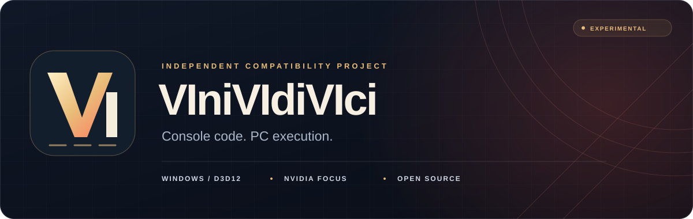

<p align="center">
  
</p>

<p align="center"><strong>An experimental Xbox Series compatibility layer for Windows, with a focus on NVIDIA.</strong></p>

<p align="center">
  <a href="LICENSE"></a>
  
  
  
</p>

<p align="center">
  <a href="#what-this-fork-adds">The changes</a> · <a href="#build-and-run">Build &amp; run</a> · <a href="#validation">Validation</a> · <a href="https://github.com/KomanderDG88/VIniVIdiVIci/issues">Report an issue</a>
  <br /><strong>English</strong> · <a href="README.es.md">Español</a>
</p>

---

## The project

**VIniVIdiVIci** brings selected compatibility fixes together, checks their behavior on an **RTX 4060 Ti**, and keeps their origins and limitations visible. The name gives each part of *veni, vidi, vici* its own **VI**.

Built on [victory-fork](https://github.com/fxceless/victory-fork) and [VIctory](https://github.com/Marvisak/VIctory), it runs a title's x86-64 code natively on the CPU and translates console GPU programs for Direct3D 12. The current work focuses on wave64 compute, memory correctness and texture updates.

> **Current status: experimental.** Synthetic tests have been checked on our hardware. This fork does **not yet publish its own gameplay frame-rate, visual-quality or session-stability results**. Results reported by upstream projects belong to their builds and machines.

No game files, assets or console SDK material are included. Supply your own files outside the repository. This is an independent community project, unaffiliated with console or game publishers and hardware vendors.

## What this fork adds

Changes below are relative to victory-fork `0b0074e`. Original authors retain their credit and history.

| Area | Change | Source |
| :--- | :--- | :--- |
| **64 lanes → 32 threads** | Paired execution for wave64 compute on 32-lane GPUs. Also includes the PR's mesh/pixel linking and related translator changes. | [#854](https://github.com/fxceless/victory-fork/pull/854) · PiloteCode |
| **Memory boundaries** | Wide shader loads and stores crossing a 64 KiB page use the mapping of each page. | [#846](https://github.com/fxceless/victory-fork/pull/846) · gomeaw |
| **Pixel helper lanes** | A helper lane reads its own value in `v_readfirstlane`, allowing the tested waterfall loop to serve it on the first pass. | [0601955](https://github.com/Marvisak/VIctory/commit/0601955361c77fd8e306631784ed084a31e5ad8f) · Vax |
| **Texture refresh** | Remap-notification overflow triggers one full revisit of placed textures. The port retains the existing memory bound and protects the batch and marker with the same lock. | [74315e7](https://github.com/PastiiJay/klbf-lab/commit/74315e765a6a7b24a926e55f9b2a192d6b8ec05a) · PastiiJay / KLBF Lab |

These are correctness changes with regression tests. They are not a claim of higher frame rates or a complete rendering fix.

## Build and run

### Requirements

- Windows 10/11 x64 and an AVX2-capable CPU.
- A Direct3D 12 GPU with Shader Model 6.6; mesh shaders are needed for world rendering. Our validation card is an NVIDIA RTX 4060 Ti.
- [Rust](https://rustup.rs/) with the MSVC C++ build tools and a Windows SDK. The repository pins Rust **1.98.1**.
- Your title files and writable cache/data folders **outside this repository**. Keep sufficient Windows committed-memory headroom available.

### 1. Get the source

```powershell
git clone https://github.com/KomanderDG88/VIniVIdiVIci.git
cd VIniVIdiVIci
Copy-Item victory.example.toml victory.toml
```

Edit `victory.toml` to point to your files. The example explains the cache and save-data paths. Then check the configuration and build:

```powershell
cargo run -p victory -- config
cargo build --release -p victory
```

### 2. Start your title

```powershell
.\target\release\victory.exe run "D:\YourTitle\title.exe" --execute
```

Replace the example path with your executable. The binary and configuration variables keep the inherited **`victory` / `VICTORY_*`** names.

XInput controllers are supported. With no controller connected, the focused window uses the keyboard as a pad: **WASD / IJKL** for the sticks, **Enter** for A, **Backspace** for B, and **Esc / Tab** for Menu / View. The full key map and advanced switches are in the [inherited runtime guide](README.upstream.md#getting-started).

## Validation

Recorded on **Windows / RTX 4060 Ti / driver 617.42**. These are synthetic checks, not a game benchmark.

| Recorded checkpoint | Result | Scope |
| :--- | :--- | :--- |
| Base integration, `1dc8914` | **247 passed**, 2 ignored | `victory-shader` library suite |
| Base integration, `1dc8914` | **170 passed**, 5 ignored | `victory-gpu` library suite |
| Remap port, `158676e` | **19 passed** | Descriptor/host tests after the texture fix |
| Pixel helper test | **18 / 18** | Helper neighbours served on hardware and WARP |
| Paired LDS tests | **30 / 30 each** | Two synthetic cases, including a 128-thread group |

Some device/compiler-dependent test paths can return early when prerequisites are unavailable. A suite's “passed” count alone does not certify execution of every hardware path. WARP does not cover the paired `WaveSize(32)` path here.

**GPU test suite, stabilised:** the intermittent failures of the full GPU suite (the WARP in-place-buffer test's decommit, a WARP access violation with tests running at once, and the indirect budget test's group order) are fixed by fxceless/victory-fork#878 (MamaLeVrai), #875 (eazyves) and a clamp that dispatches one group per 64 records, after #864 (xiaotu030202). Thirty runs of the whole `victory-gpu` test binary on an RTX 4060 Ti: 30 of 30 clean (171 passed, 5 ignored), against 25 of 30 before. The clamp change costs about 1.4 µs per 64 records and is not a frame-rate improvement.

The page-boundary and texture-overflow regressions were also checked by removing their respective fixes: the tests detect the resulting wrong behavior.

<details>
<summary><strong>Run the checks yourself</strong></summary>

Set `VICTORY_PC_DXC` to your Windows SDK's PC `dxc.exe` for compiler-dependent tests. GPU checks require a suitable device; inspect the output for skipped paths.

```powershell
cargo xtask install-hooks
cargo xtask policy
cargo test -p victory-shader --lib -- --nocapture --test-threads=1
cargo test -p victory-gpu --lib -- --nocapture --test-threads=1
```

For a runtime build with diagnostics:

```powershell
cargo build --profile diag -p victory --features diagnostics
```

The executable is then `target\diag\victory.exe`. See the [diagnostics reference](README.upstream.md#debugging) and [architecture](docs/architecture.md).

</details>

## What's next

- Measure this fork in a repeatable gameplay scene, with the exact commit, driver, settings and cache state recorded.
- Compare image correctness and stability before drawing conclusions about performance.
- Review further texture readback and memory-notification fixes independently, with tests for their interactions.

## Contribute

Small, attributable changes with a reproducible test are welcome. For a bug report, include the commit, hardware, driver, relevant settings, steps and expected versus actual behavior. Review logs before sharing; omit personal paths and private data.

Use **synthetic fixtures** for tests. Game executables, assets, extracted shaders and derived dumps do not belong in issues or pull requests. See the [asset policy](docs/asset-policy.md).

## Built on other people's work

**Marvisak and the VIctory contributors** built the foundation. **fxceless and the victory-fork contributors** developed the runtime this fork follows. Thanks to **PiloteCode, gomeaw, Vax and PastiiJay**, and to the contributors credited throughout the preserved history.

The [inherited README](README.upstream.md) retains earlier attribution and technical notes. Its historical performance numbers do not describe this fork. The header and VI monogram are original vector artwork created for VIniVIdiVIci.

**GPL-3.0-or-later** · [License](LICENSE) · [Source](https://github.com/KomanderDG88/VIniVIdiVIci) · [Issues](https://github.com/KomanderDG88/VIniVIdiVIci/issues)
